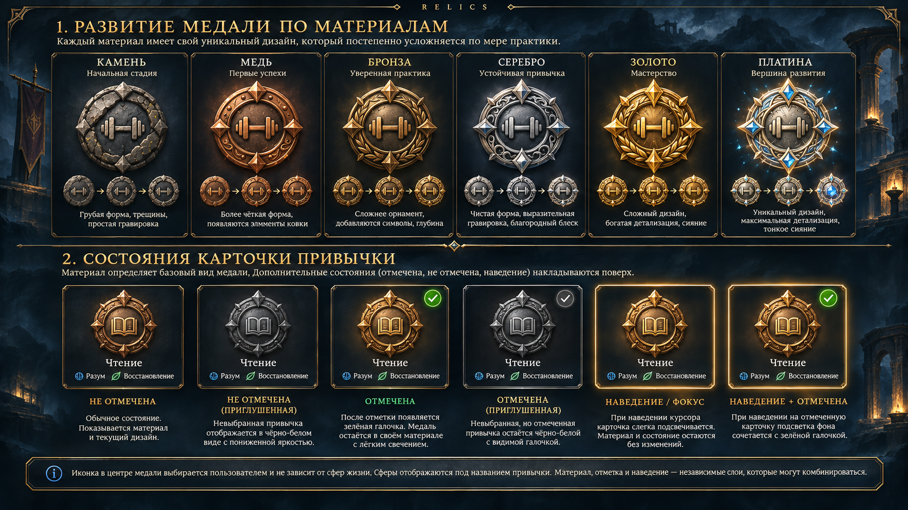

# HABIT-SIGILS-001A — queued owner brief, not started

## Transfer instruction takes precedence
On 2026-11-01 the owner requested: first merge the accepted HABIT-RHYTHM-001 PR #13 into master,then stop for a move to another computer. This file preserves the supplied next task and its mandatory addendum;it does not mark implementation started. Do NOT create the implementation branch or begin components/artwork/showcase until the owner resumes on the second computer.

The attached full brief below is owner-supplied source. Its instruction to create a HABIT-SIGILS-001A branch is deferred by the later stop instruction. Read AGENTS.md,HANDOFF.md and the latest master before resuming.

## Mandatory replaceable icon architecture — owner addendum
The center icon must NEVER be baked into medal artwork. All18 base states(six materials × three craftsmanship stages) need a reusable empty center slot and independently replaceable SVG icons through an iconId prop.
- One consistent normalized icon viewport across all materials/stages.
- Icon switching must not regenerate or modify medal artwork.
- Material-appropriate icon treatment;the same icon remains recognizable from Stone through Platinum.
- Icon choice is independent of material,Forging,Resonance and sphere contributions.
- Demonstrate LIVE icon switching on at least Stone,Bronze,Gold and Platinum in the isolated visual showcase.
- The reference dumbbell is illustrative,never a permanent baked-in medal center.
- This architecture is required in001A;do not defer it to001B.
- 001B implements the actual icon picker in BOTH Create and Edit,persists iconId through an additive SQLite migration and backupv4,and supplies a neutral legacy default.
- 001A changes neither schema5/backupv3 nor production habit cards;all stage/light samples are clearly synthetic.

## Portable visual reference

Original PNG supplied by the owner on2026-11-01,copied without editing from codex-clipboard-7ae5e3f4-278e-43c5-9e63-9d735f202f8c.png. Documentation/reference-only;not a runtime asset,not approved rendered component output,not an implementation shortcut. Do not crop it into runtime medals. Text describing grayscale in the board does not override the approved requirement to retain material identity in subdued states. Existing Sanctuary remains authoritative.

## Owner-supplied full task

# RELICS — HABIT-SIGILS-001A
## Visual Medal System — Six Materials, Three Evolution Stages

Repository: https://github.com/Maximus1978/Relics

**Task type: Visual component implementation and owner design approval.**

This task delivers a functional, rendered visual system for future habit medals, but does NOT replace the production habit inventory yet.

## 0. Prerequisite — HABIT-RHYTHM-001

The owner has functionally accepted HABIT-RHYTHM-001 on Windows.

PR #13:
https://github.com/Maximus1978/Relics/pull/13

Reviewed head:
`2314cbf08692e3073baf029e90ac2618bd641b1d`

Tested implementation:
`4969d7afe193fc924c616554295a8c250b0e5378`

Successful Windows CI:
https://github.com/Maximus1978/Relics/actions/runs/41262296440

First verify:

- PR #13 is still mergeable.
- The successful CI corresponds to the tested implementation.
- Only documentation changed after the tested commit.
- No newer conflicting changes exist.

Then merge PR #13 normally into master and verify the merge SHA.

Record owner functional acceptance. Do not claim that a separately confirmed offline restart occurred.

Create a new branch for HABIT-SIGILS-001A.

If the prerequisite merge fails, stop and report.

## 1. Objective

Create a cohesive, high-quality, dark-fantasy habit medal visual system.

Ordinary habit medals must evolve through six materials:

1. Stone
2. Copper
3. Bronze
4. Silver
5. Gold
6. Platinum

Each material must have three progressive craftsmanship stages.

Total: **18 clearly distinguishable base states.**

The key requirement is actual visual development, not recoloring the same medal.

Study:

- `docs/PROGRESS_001.md`
- `docs/art/HABIT_MEDALS.md`
- Existing `RelicArt` and inventory styling.
- Existing Sanctuary artwork and its accepted visual direction.
- The owner-provided medal concept board, if accessible.

Preserve the original accepted Sanctuary environment.

## 2. One Visual Family, Not 18 Unrelated Medals

Use one coherent ordinary-medal design system.

Maintain:

- A shared central icon area.
- Consistent relative proportions.
- Registered layers and alignment.
- Related outer medal geometry.
- Coherent dark-fantasy engraving language.

However, materials must differ meaningfully through:

- Manufacturing style.
- Shape details.
- Surface texture.
- Edge construction.
- Ornament complexity.
- Relief depth.
- Material appearance.

Do NOT create a single SVG and change its fill color six times.

Do NOT generate eighteen unrelated random medal illustrations.

The result should look like one object evolving through a consistent craftsmanship tradition.

## 3. Material Art Direction

### Stone

Rough, irregular, chipped stone.

Stage 1: coarse primitive carved token with cracks.

Stage 2: more deliberate shaping and improved edge definition.

Stage 3: carved border and initial runic details.

Stone remains recognizable as stone, not grey metal.

### Copper

Early forged craftsmanship.

Stage 1: simple copper disc with hammered texture.

Stage 2: defined rim, subtle rivets or edge details.

Stage 3: modest decorative engraving.

Warm, worn copper with authentic metal texture.

### Bronze

More accomplished metalworking.

Stage 1: strong cast-bronze construction.

Stage 2: improved relief and controlled decorative borders.

Stage 3: richer carved motifs and stronger craftsmanship.

Clearly more advanced than copper, but still restrained.

### Silver

Refined ornamental craft.

Stage 1: clean silver body and precise rim.

Stage 2: deeper relief and decorative accents.

Stage 3: elegant filigree and layered structural details.

Avoid excessive brightness that makes every stage identical.

### Gold

Prestigious, elaborate workmanship.

Stage 1: noble gold structure.

Stage 2: increasingly elaborate engraving and relief.

Stage 3: sophisticated ornament and finely finished details.

The gold must remain recognizable even without glow.

### Platinum

Top-tier ordinary craftsmanship.

Stage 1: distinctive, advanced platinum construction.

Stage 2: intricate layered details and refined geometry.

Stage 3: masterwork-level engraving, precise ornament and controlled luminous accents.

Platinum should look genuinely special but must NOT compete with future unique Legendary Artifacts.

## 4. Within-Material Evolution

Each material contains three fixed visual stages.

The design must evolve predictably.

Avoid arbitrary new silhouettes within the same material.

Examples of progression:

- More refined borders.
- Added engraved details.
- Increased relief depth.
- Improved decorative craftsmanship.
- New carefully registered ornaments.

Do not use glow as the only indicator of progression.

The permanent stage is independent of temporary illumination.

No material or ornament degradation from inactivity.

Exact gameplay thresholds for reaching stages remain PROGRESS-001 candidates and are NOT implemented in this task.

## 5. Manual Icon System — Visual Foundation

Create a small cohesive preview gallery of center icons.

Recommended starter icons:

- Generic sigil.
- Walking.
- Strength/fitness.
- Reading.
- Language learning.
- Guitar/music.
- Bicycle.
- Conversation/relationships.
- Work.
- Sleep/rest.
- Meditation.
- Creativity.

All icons should:

- Use matching stroke and proportion systems.
- Fit the same normalized central viewport.
- Render consistently on all materials.
- Follow the material's visual treatment.
- Remain legible at compact card sizes.

The selected icon is independent of life spheres.

No sphere-based colored center gemstones.

No automatic icon changes based on selected spheres.

This task introduces only reusable icon visuals and previews.

**Do not add icon persistence or an editable icon field to SQLite yet.**

Persistent manual selection belongs to HABIT-SIGILS-001B.

## 6. Independent Visual Layers

Develop components that can later combine:

**Layer A — Mastery**

Permanent material, geometry, texture and ornament stage.

**Layer B — Center Icon**

Manual icon, independently registered and themed to the material.

**Layer C — Resonance**

Temporary illumination intensity, parameterized from 0 to 1.

This can affect inner light, rim accents and restrained halo.

It must not change material color or permanent ornament.

**Layer D — Selected-Day Completion**

Completed: clear green checkmark in a card corner.

Uncompleted: no checkmark.

Completed and uncompleted medals retain their earned material.

The card may be subdued when uncompleted, but must never fully grayscale the medal.

The green checkmark must remain clear even when Resonance is zero.

**Layer E — Interaction**

Rest, hover, keyboard focus and pressed/touch presentation.

Interaction never creates a fake completion state.

The focus ring must remain visible.

Use a separate future card-action component for actual logging.

## 7. Visual Architecture

Prefer reusable SVG/CSS components, registered transparent art layers and parameterized lighting.

Use source artwork where it materially improves painterly quality.

Avoid screenshot cropping as runtime assets.

Avoid rendering every combination as a separate bitmap.

Avoid random variation and mismatched center alignment.

Do not alter the accepted central seven-day rune.

Do not accidentally reuse its fixed-geometry rule for ordinary habit medals: ordinary medal geometry is allowed to evolve by material and craftsmanship stage.

The central rune and ordinary habit medals are separate objects.

The system must support future real Mastery values without rewriting the entire artwork implementation.

## 8. Isolated Visual Showcase

Create a visual development showcase that does not modify the production habit inventory.

The showcase must demonstrate:

- All 18 material/stage combinations at equal scale.
- At least four different center icons.
- Completed and uncompleted card states.
- Three representative Resonance levels: 0 / 0.5 / 1.
- Hover and keyboard focus states.
- Representative compact mobile layouts.
- Reduced-motion behavior.

Use clearly labeled synthetic fixtures.

The preview must never imply that the user already earned Gold or Platinum.

If the original reference board cannot be accessed, document the limitation. Do not claim that an unrelated substitute artwork matches the approved reference.

Owner approval of rendered assets is required before replacing real habit cards.

## 9. Quality Gate — Very Important

The owner strongly dislikes variants that are technically different but visually almost identical.

Before delivery, compare every neighboring material tier and every neighboring ornament stage.

At normal inventory scale, users should recognize:

- Material differences immediately.
- Stage advancement through actual detail changes.
- Completed/uncompleted state without reading a button label.
- Manually selected icons without relying on sphere colors.

Do not add decorative complexity that destroys readability.

Show the medals at realistic production dimensions, not only in oversized illustrations.

If 18 states are not meaningfully distinguishable, do not declare the art task visually complete.

Explain which ones need more refinement.

## 10. Visual Evidence

Provide actual captured output from the implemented component, not only concept art.

Required:

1. One 6-column × 3-stage material contact sheet.
2. A material comparison at compact card scale.
3. Center-icon comparison.
4. Completed/uncompleted comparison.
5. Resonance 0 / 0.5 / 1 comparison.
6. Hover/focus comparison.
7. Narrow-screen/mobile preview.
8. An overlay/alignment proof for central icon positioning.

All screenshots must correspond to the delivered source code.

No fake hand-painted screenshots disconnected from runtime implementation.

## 11. Engineering Constraints

This task must not modify:

- Existing SQLite schema 5.
- Backup v3.
- Frequency history.
- Activity snapshots.
- Archived-habit lifecycle.
- Rune and shrine state calculations.
- Life Rhythm.
- Chronicle.
- Existing production logging behavior.
- Existing production habit cards.

No Mastery/Forging/Resonance calculation engine.

No permanent tier state stored in SQLite.

No replacement of the current completion button yet.

No full-card logging interactions in production.

All visual stage values in the showcase are synthetic fixtures.

## 12. Tests

Run existing tests and CI.

Add focused visual/component checks for:

- Six valid material tiers.
- Three stages for each tier.
- Icon registration.
- Material persistence under subdued states.
- Completion check independent of Resonance.
- Hover/focus independent of completion.
- Invalid props/fallback states.
- Responsive behavior.
- Accessible descriptions.
- Reduced motion.

Check all 18 base states programmatically.

Capture representative combinations; full 432-state runtime testing belongs to later integration.

Maintain Windows offline build compatibility.

## 13. Roadmap

Update the roadmap with an explicit staged split:

**HABIT-SIGILS-001A — current task**

Visual medals, material/stage system, icon visuals and owner design review.

**HABIT-SIGILS-001B — future**

Manual icon selection in Create/Edit, icon identity persistence, additive migration and backup v4 compatibility.

**HABIT-SIGILS-001C — future**

Compact production habit cards, green completion check, full-card interaction, separate management menu and accessible cancellation.

**PROGRESS-002A — future**

Actual deterministic Mastery, Forging and Resonance calculation engine, after numerical rules are approved.

**PROGRESS-002B — future**

Connect real progression values to medal material, stages, forging indicator and temporary light.

If combining later small tasks is safer, document the rationale, but do not start them automatically.

Preserve all other approved roadmap tasks.

## 14. Delivery

Create one focused PR for HABIT-SIGILS-001A.

Include:

- PR URL.
- Verified commit SHA.
- Successful CI.
- Windows build if the new components are included in the app build.
- Real rendered contact sheets.
- Comparison against accepted art direction.
- Identified visual limitations.
- Owner review instructions.

Update relevant art/design docs, ROADMAP and HANDOFF.

**Do not automatically merge HABIT-SIGILS-001A.**

**Do not begin HABIT-SIGILS-001B, 001C or PROGRESS-002A.**

Report results in Russian and stop for owner visual approval.

## Primary Goal

Deliver a distinctive and cohesive progression of ordinary habit medals that feels earned, increasingly crafted and visually rewarding, without confusing permanent mastery, daily completion and temporary Resonance.
